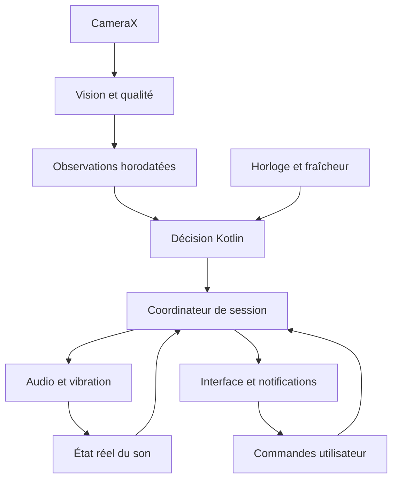

# Architecture proposée

Statut : conception uniquement, modules à créer après autorisation.

## Organisation du projet

| Module prévu | Responsabilité | Dépendances autorisées |
| --- | --- | --- |
| `:core` | Observations numériques, fenêtres temporelles, règles, état de session, politique d'alerte, horloge injectable | Kotlin et coroutines ; aucune classe Android ou MediaPipe |
| `:vision` | CameraX, traitement des images, adaptateur MediaPipe, extraction des signaux et contrôle de qualité | Android, CameraX, MediaPipe, contrats de `:core` |
| `:audio` | Sons locaux, focus, préférences et observation des routes, vibration | Android et contrats de `:core` |
| `:data` | DataStore : préférences, calibration et dernier arrêt de session | Android, DataStore, contrats de `:core` |
| `:app` | Compose, ViewModels, service caméra, notifications, coordination et injection manuelle | Les quatre modules précédents |

Pas de backend, réseau, base distante ou système d'authentification. Une injection manuelle suffit à la V1 ; elle rend les faux composants utilisables dans les tests.

## Flux de données

Le moteur décide d'une alerte demandée. L'adaptateur audio rapporte séparément si elle joue, est coupée manuellement, interrompue ou en erreur. Le texte « son en cours » ne découle jamais seulement de l'état `ALERTING`.

## Contrats de données à implémenter

| Contrat | Contenu minimal | Règle |
| --- | --- | --- |
| Observation faciale | Identifiant de session, temps monotone, EAR gauche/droite, blendshapes utiles, orientation relative, validité de chaque mesure | Valeurs absentes distinctes de zéro ; pas d'image ni de landmarks complets dans `:core` |
| Qualité de suivi | Visage dans la zone conducteur, taille exploitable, pose, cohérence géométrique, fraîcheur et causes d'indisponibilité | L'adaptateur ne fabrique pas un score de confiance par œil absent de l'API |
| Instantané moteur | État, niveau de risque, motifs, durées, couverture de fenêtre, compteur d'épisodes | Immuable ; diffusé via StateFlow |
| Commande d'alerte | Identifiant d'épisode, niveau, démarrage/arrêt | Dédupliquée et idempotente |
| État audio | Préférence, route observée pendant lecture, heure du test, focus, lecteur, défaut éventuel | Ne pas conserver une route comme « actuelle » lorsque rien ne joue |
| Événement de commande | Démarrer, arrêter le son, terminer, tester, modifier les réglages hors session | Référencé à la session courante ; les anciennes actions sont ignorées |

Le moteur reçoit des observations et des ticks d'horloge. Ces ticks permettent de repérer une caméra figée lorsqu'aucun résultat n'arrive. Un callback vision périmé ou issu d'une session terminée ne peut pas lancer une alerte.

## Propriétaire du cycle de vie

Le coordinateur de session appartient au service, pas au ViewModel. Le service conserve son cycle CameraX actif pendant une session autorisée, même lorsque l'activité passe en arrière-plan. CameraX offre un cycle de vie personnalisé pour découpler ces responsabilités [S18].

1. L'utilisateur prépare le téléphone à l'arrêt et lance la session depuis une activité visible.
2. L'activité vérifie les prérequis puis lance le service caméra ; le service publie immédiatement sa notification de premier plan.
3. La caméra, le modèle et l'analyse démarrent ; l'état reste `INITIALIZING` jusqu'à une observation exploitable.
4. L'interface se lie au StateFlow du service ; changer d'écran ou recréer l'activité ne recrée pas la session.
5. « Arrêter l'alerte » coupe le lecteur/vibreur et modifie l'état sonore ; la caméra continue.
6. « Terminer la surveillance » invalide l'identifiant de session, arrête le lecteur, libère focus/caméra/modèle/exécuteurs et retire les notifications.
7. Après mort de processus, la session est inactive. Aucun redémarrage caméra silencieux ; le retour utilisateur indique que la session précédente a été interrompue si le marqueur persistant le permet.

Permissions prévues : CAMERA, FOREGROUND_SERVICE, FOREGROUND_SERVICE_CAMERA, VIBRATE, POST_NOTIFICATIONS sur API 33+. Toute permission supplémentaire devra avoir une fonction et un test explicites. Le type principal prévu est `camera`. La nécessité d'un type supplémentaire pour l'usage audio retenu sera revue avec le manifeste final ; ne pas ajouter systématiquement un type de lecteur musical.

## Acquisition et traitement

CameraX utilise `ImageAnalysis` avec `STRATEGY_KEEP_ONLY_LATEST` [S19]. L'analyse ne dépend pas de la présence du Preview. Pour MediaPipe, le mode live et ses résultats asynchrones sont adaptés au flux [S5].

Choix de conception : une image détenue par l'analyseur et au maximum une inférence en vol, avec transfert explicite de propriété des buffers. Une copie peut être nécessaire avant de fermer l'ImageProxy ; ne jamais le fermer tant qu'un traitement lit encore son contenu. Libérer chaque ressource sur réussite, rejet ou erreur. Les images et MPImage restent uniquement en mémoire.

Les transformations tiennent compte de la rotation et du format. L'analyse reçoit une image non miroir ; seul l'aperçu peut être miroir. Les points normalisés sont remis à l'échelle selon la largeur et la hauteur avant les rapports géométriques. L'estimation de pose doit être vérifiée avec les conventions de repère du modèle.

L'horodatage de décision provient d'une horloge monotone unique à l'entrée de la chaîne. Le timestamp capteur brut reste une donnée de diagnostic : ne pas le soustraire directement à une autre base de temps sans en avoir validé la correspondance. Les résultats en retard sont rejetés selon leur âge et leur session.

## Audio, notification et disponibilité

Un lecteur local basé sur AudioTrack est proposé pour contrôler le son et observer le routage. Les sons seront embarqués et posséderont leurs droits de redistribution. Une rampe brève évite les attaques brutales, mais l'arrêt manuel ne dépend pas de la fin d'un fichier.

La commande d'arrêt traverse une voie prioritaire : elle doit invalider la lecture immédiatement même si l'inférence tarde. Un seul lecteur d'alerte existe par session. Le test sonore et l'alerte réelle ne peuvent pas se superposer ; une urgence remplace le test.

Deux notifications sont prévues : service actif avec action de fin de session ; alerte avec action d'arrêt du son. Intents explicites, identifiants distincts et PendingIntent immuables. Pas d'overlay, lancement forcé d'activité ou plein écran imposé. Son de notification et lecteur ne doivent pas produire un double signal.

La disponibilité visuelle et la disponibilité sonore sont deux axes indépendants. Une panne audio ne change pas des yeux ouverts en yeux fermés ; une panne vision ne prouve pas la récupération. Si une alerte existait avant une perte de suivi, son arrêt automatique reste interdit jusqu'à une réouverture fiable ou un arrêt manuel.

## Persistance et confidentialité

DataStore contient uniquement les réglages, les références scalaires de calibration et un marqueur minimal de session interrompue. Les landmarks, images, score continu et historique de trajets ne sont pas persistés. Une calibration peut être supprimée en une action et doit être exclue des sauvegardes automatiques.

La télémétrie de mise au point est locale, sans images et désactivée par défaut dans la version distribuée. Les vidéos de validation restent dans un espace de test distinct, consenti, avec durée de conservation définie ; elles ne font pas partie du fonctionnement normal ni du dépôt public.

Références : [sources](08_SOURCES.md).
